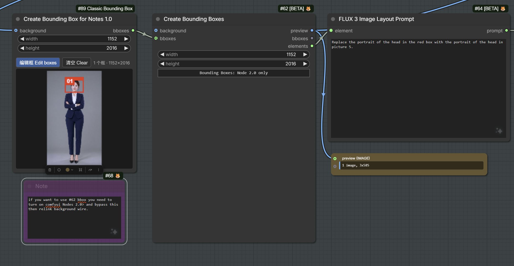

# Create Bounding Box for Notes 1.0

**中文：** 把 ComfyUI 核心节点 Create Bounding Boxes 的画框编辑器，在原节点基础上做成经典界面（Nodes 1.0）也能用的版本；原节点的文件完全不改。

**⚠️ 本节点不能单独使用**，必须和原版核心节点 Create Bounding Boxes 一起用：把本节点的 `bboxes` 输出接到 Create Bounding Boxes 的 `bboxes` 输入，后面继续用 Create Bounding Boxes 的 `preview`、`bboxes`、`elements` 输出。

**English:** The core ComfyUI Create Bounding Boxes box editor, made usable in the classic UI (Nodes 1.0) on top of the original node. The original node's files are not modified.

**⚠️ This node does not work on its own.** It must be used together with the original core Create Bounding Boxes node. Connect this node's `bboxes` output to the `bboxes` input of Create Bounding Boxes, then keep using that node's `preview`, `bboxes` and `elements` outputs.

> 仓库 / Repository: `https://github.com/1113800942/comfy-classic-bounding-box`

- 显示名 Display name: `Create Bounding Box for Notes 1.0`
- 内部 ID Internal node ID: `ClassicCreateBoundingBox`
- 分类 Category: `utilities`

---

## 中文

### 这是什么
核心的 Create Bounding Boxes 节点只在 Nodes 2.0（Vue）界面里能画框。本节点是放在它前面的一个小助手节点：你在经典界面里画框，节点把框转成像素坐标，从 `bboxes` 输出接到 Create Bounding Boxes 的可选 `bboxes` 输入。真正生成预览和 elements 的仍然是核心节点。

### 安装
把整个 `Classic Bounding Box` 文件夹放进 `ComfyUI/custom_nodes/`，然后重启 ComfyUI。没有额外依赖。

### 输入 / 输出
- `width` / `height`（INT，默认 720 / 1280）：像素坐标网格，**必须和它接入的 Create Bounding Boxes 节点的 width/height 填同样的数**。核心节点会用它自己的 width/height 把像素换算回比例。
- `boxes_json`：编辑器保存的框数据（隐藏，随工作流保存），一般不用手动改。
- `background`（IMAGE，可选）：编辑器里显示在框后面的图，任意图片都可以。
- 输出 `bboxes`（BOUNDING_BOX）：`[{x, y, width, height, metadata}]` 列表。

### 使用
1. 在节点上点 **编辑框 Edit boxes**（或点击节点里的预览图）打开全屏编辑器。节点上的 **清空 Clear** 会清空这个节点上的所有框。
2. 背景图：如果 `background` 接的是 Load Image 这类节点，编辑器会直接显示那张图；否则运行一次后会显示这次运行的背景图。没有背景时显示 width×height 的灰色区域。
3. 选颜色：
   - 单色：红、蓝、绿、黄、橙、紫、青、粉、白、黑，另有一个自定义取色器。
   - 配色：`红/蓝/绿`、`红/绿/黄`。
   - 选好后在空白处拖动，就画出这个颜色的框。框线用配色的第一种颜色，框顶会显示配色色条。
4. 多个框：
   - 可以画任意多个框。拖框内部是移动，拖白色手柄是调大小，按 Delete/Backspace 删除选中的框。
   - 右侧列表按“先背景后前景”排列，可以用“上移 / 下移”调整顺序，用“删除”删框，“改用当前颜色”把当前颜色套到选中的框上。
5. 每个框可以设置：
   - 类型：`物体 obj` 或 `文字 text`。新框的默认类型在顶部“新框类型”里选。
   - 文字：仅 text 类型。
   - 描述 desc。
6. 点 **完成** 保存，点 **取消 (Esc)** 放弃修改，点 **清空全部** 清除编辑器里的所有框。
7. 接线：把本节点的 `bboxes` 输出接到 Create Bounding Boxes 的 `bboxes` 输入，两边的 width/height 设成一样。

如果没画框，输出是空列表，核心节点会退回使用它自己编辑器里存的框。

### 注意
- Flux3LayoutPrompt 生成的布局文字不使用框的颜色，只用每个框的文字和描述。所以请给每个框写上描述，比如“红衣女孩”。
- 框只是构图/布局提示，不是局部重绘（inpainting）遮罩，不能保证框外的内容不变。

---

## English

### What it is
The core Create Bounding Boxes node can only draw boxes in the Nodes 2.0 (Vue) UI. This is a small helper node placed in front of it. You draw boxes in the classic UI, and the node converts them to pixel boxes and sends them from its `bboxes` output into the optional `bboxes` input of Create Bounding Boxes. The core node still produces the preview and the elements.

### Install
Put the whole `Classic Bounding Box` folder into `ComfyUI/custom_nodes/` and restart ComfyUI. There are no extra dependencies.

### Inputs / output
- `width` / `height` (INT, default 720 / 1280): the pixel grid. **These must be the same numbers as the width/height of the Create Bounding Boxes node it feeds**, because the core node converts the pixels back to fractions using its own width/height.
- `boxes_json`: the box data saved by the editor. It's hidden, saved with the workflow, and normally not edited by hand.
- `background` (IMAGE, optional): an image shown behind the boxes in the editor. Any image works.
- Output `bboxes` (BOUNDING_BOX): a list of `[{x, y, width, height, metadata}]`.

### Usage
1. Click **编辑框 Edit boxes** on the node, or click the preview inside the node, to open the full-screen editor. **清空 Clear** on the node removes all boxes from that node.
2. Background: if `background` comes from a node such as Load Image, the editor shows that image directly. Otherwise it shows the background from the last run. With no background, a gray width×height area is shown.
3. Pick a color:
   - Single colors: red, blue, green, yellow, orange, purple, cyan, pink, white and black, plus a custom color picker.
   - Palettes: red/blue/green and red/green/yellow.
   - Then drag on an empty area to draw a box in that color. The outline uses the palette's first color, and a palette strip is shown along the top of the box.
4. Multiple boxes:
   - Draw as many boxes as you need. Drag inside a box to move it, drag the white handles to resize it, and press Delete/Backspace to delete the selected box.
   - The side list is ordered background first, then foreground. Use 上移 / 下移 (up/down) to reorder, 删除 (delete) to remove, and 改用当前颜色 to apply the current color to the selected box.
5. Per box, you can set:
   - Type: `obj` or `text`. The type for new boxes is chosen in the top bar.
   - Text: text type only.
   - Description (desc).
6. Click **完成** (Done) to save, **取消 (Esc)** to discard changes, or **清空全部** to clear all boxes in the editor.
7. Wiring: connect this node's `bboxes` output to the `bboxes` input of Create Bounding Boxes, and set the same width/height on both nodes.

If no boxes are drawn, the output is an empty list and the core node falls back to the box stored in its own editor.

### 示例 / Example

本节点的 `bboxes` 接到 Create Bounding Boxes 的 `bboxes` 输入，Create Bounding Boxes 的 `elements` 再接到 FLUX 3 Image Layout Prompt。

This node's `bboxes` goes into the `bboxes` input of Create Bounding Boxes, and Create Bounding Boxes' `elements` output goes into FLUX 3 Image Layout Prompt.

### Notes
- Flux3LayoutPrompt's layout text does not use box colors, only each box's text and description. Write a description for every box, for example "girl in a red dress".
- Boxes are layout hints, not an inpainting mask. They do not guarantee that content outside a box stays unchanged.

---

## License / 许可证
GPL-3.0. See [LICENSE](LICENSE). 本项目使用 GPL-3.0 许可证，见 LICENSE。
